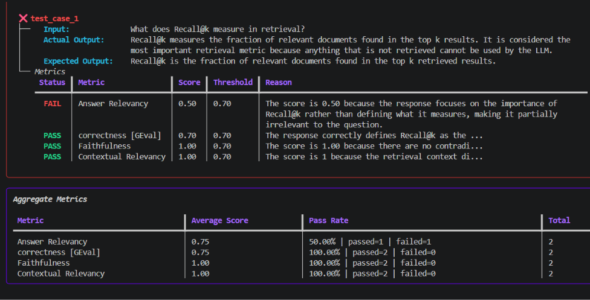

# Simple RAG Pipeline and Evaluation

A small retrieval-augmented generation (RAG) project that reads a PDF, retrieves relevant passages, answers questions from that context, and evaluates the answers with DeepEval.



The screenshot highlights one test case and the aggregate results from the current tiny evaluation run. The dataset currently contains **two questions**, so these scores are an example of how the evaluation works—not a statistically reliable benchmark.

## What this project does

1. Extracts text blocks from a PDF and adds them to an in-memory vector store.
2. Uses Google embeddings and similarity search to retrieve up to three relevant passages.
3. Uses a Gemini-powered LangChain agent to answer each question from retrieved PDF context.
4. Evaluates the generated answers with four DeepEval metrics.

## Evaluation metrics

Each metric uses a `0.7` pass threshold in `deepeval_onrag.py`.

| Metric | What it checks |
| --- | --- |
| Answer Relevancy | Whether the generated answer addresses the question. |
| Correctness (GEval) | Whether the answer is relevant and consistent with the expected answer. |
| Faithfulness | Whether claims in the answer are supported by the retrieved context. |
| Contextual Relevancy | Whether the retrieved context is relevant to the question. |

## Models and rate limits

- **RAG answer generation:** `gemini-3.6-flash` through LangChain.
- **Embeddings:** `gemini-embedding-001`.
- **DeepEval judge:** `openai/gpt-oss-20b` through Groq's OpenAI-compatible API.
- **Evaluation execution:** sequential (`run_async=False`). This avoids parallel request bursts that can run into provider rate limits on free or limited-allowance API tiers.

Model availability and quotas depend on the provider and account. A sequential run can still be affected by temporary service errors or exhausted quotas. For a larger follow-up project, I plan to try a paid OpenAI model and compare its evaluation quality and capacity.

## Project files

| Path | Purpose |
| --- | --- |
| `Rag-1/pdf_reader.py` | Extracts text blocks from the PDF. |
| `Rag-1/indexing.py` | Creates embeddings and an in-memory vector store from the PDF. |
| `Rag-1/tools.py` | Retrieves the top three matching passages. |
| `Rag-1/agents.py` | Defines the RAG agent and its `ask()` function. |
| `eval_dataset.json` | Small JSON-array dataset of questions and expected answers. |
| `eval_run1.py` | Runs the RAG pipeline for each dataset question and writes `eval_result1.json`. |
| `deepeval_onrag.py` | Runs DeepEval metrics and writes `evaluated_results.json`. |
| `pdfs/llm_agent_eval_metrics_text.pdf` | Source PDF indexed by the RAG pipeline. |

## Requirements

- Windows, PowerShell, and Python 3.14 (the version selected by `.python-version`).
- [uv](https://docs.astral.sh/uv/) for installing the locked project dependencies.
- A Google API key with access to the Gemini model and embeddings used by this project.
- A Groq API key with access to `openai/gpt-oss-20b`.

## Setup

From the project root, sync the dependencies and create a local environment file if you do not already have one:

```powershell
uv sync
if (-not (Test-Path .env)) { Copy-Item .env.example .env }
```

Edit `.env` and replace the placeholders with your own API keys:

```dotenv
GOOGLE_API_KEY=your_google_api_key
GROQ_API_KEY=your_groq_api_key
```

Keep `.env` private; it is ignored by Git. Do not put real API keys in source code or commit them.

## Run the evaluation

Run the scripts from the project root, in order:

```powershell
uv run python eval_run1.py
uv run python deepeval_onrag.py
```

The first command reads `eval_dataset.json`, asks the RAG agent each question, and writes `eval_result1.json` as a JSON array. The second command evaluates those cases and writes one JSON object per line to `evaluated_results.json`.

To add or change test cases, edit `eval_dataset.json`. It must remain a JSON array, and each item must include `question` and `expected_answer`, for example:

```json
[
  {
    "question": "What does Recall@k measure in retrieval?",
    "expected_answer": "Recall@k is the fraction of relevant documents found in the top k retrieved results."
  }
]
```

## Notes and limitations

- The vector store is in memory and is rebuilt from the PDF when the application starts.
- This is a deliberately small learning project; its two-question dataset is not enough to draw strong conclusions about overall RAG quality.
- LLM-as-a-judge scores can vary between runs. Review metric reasons and examples rather than treating a threshold as proof of correctness.
- Provider rate limits, model availability, and API pricing can change. If a call fails, check the latest error and the relevant provider's account limits.

## A note from me :

I wrote the pipeline and evaluation code myself as a way to build coding muscle memory, and I’m proud of the progress that came from working through the implementation. This project is a hands-on learning milestone and a foundation for the next, more capable RAG evaluation project.
